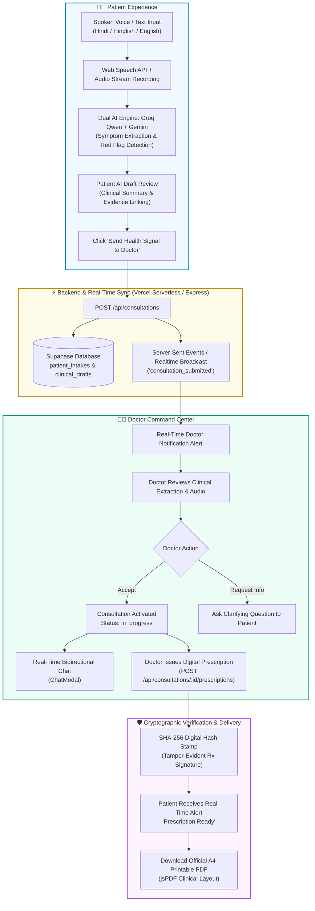

# CLARIO.2

<div align="center">

# 🩺 Clario 2.0
### Next-Gen AI Multilingual Teleconsultation, Clinical Intake & Prescription Platform
*Evidence-Backed Multilingual Healthcare • हर आवाज़ मायने रखती है (Every Voice Matters)*

[](https://react.dev/)
[](https://vitejs.dev/)
[](https://www.typescriptlang.org/)
[](https://groq.com/)
[](https://ai.google.dev/)
[](https://supabase.com/)
[](https://vercel.com/)
[](LICENSE)

<br/>


</div>

---

## 🌟 Executive Overview

**Clario 2.0** is an enterprise-grade AI healthcare teleconsultation ecosystem designed to bridge communication barriers between patients and doctors across linguistic diversity. In regions where hundreds of millions speak vernaculars and mixed dialects such as **Hindi, Hinglish, and regional Indian languages**, describing nuanced symptoms, pain intensity, and medical history under stressful clinical conditions is a major bottleneck.

Clario allows patients to simply **speak or type their symptoms naturally in their mother tongue**. Our integrated **Dual-Engine AI pipeline (Groq Qwen 27B + Google Gemini)**:
1. Captures live audio with animated waveform visualization.
2. Transcribes and normalizes colloquial phrases (e.g., *"seene me dawab"*, *"pet me marod"*, *"raat ko khansi zyada"*).
3. Performs clinical fact extraction anchored directly to patient speech quotes to prevent AI hallucination.
4. Identifies emergency red flags (cardiac indicators, acute distress, breathing difficulties) and triggers instant triage alerts.
5. Delivers the verified clinical intake in real-time to the assigned physician's dashboard (e.g. **Dr. Priya Sharma**).
6. Enables doctors to review clinical evidence, accept consultations, initiate live bidirectional chat, and issue **cryptographically verified digital prescriptions (SHA-256)** downloadable as hospital-grade A4 printable PDFs.

---

## 📸 Visual Showcase

<div align="center">

### 1. Multilingual Symptom Voice Studio & AI Clinical Intake
Patients record or describe their symptoms in Hindi, Hinglish, or English with real-time waveform capture.


---

### 2. Patient Command Center & Real-Time Tracking
Patients track consultations, pending reviews, doctor notes, and quick health signals.


---

### 3. Doctor Review Dashboard & Clinical Queue
Physicians receive live incoming patient requests, clinical urgency ratings, and draft approvals.


---

### 4. Patient & Doctor Portals with Role-Based Authentication
Independent login pathways for patients and medical practitioners with Supabase Auth.


</div>

---

## 🏗️ End-to-End System Architecture



---

## ✨ Core Features & Innovations

### 🎙️ 1. Multilingual Voice & Colloquial Symptom Intake
- **Languages Supported**: Hindi, Hinglish (mixed colloquial Hindi-English), and standard English.
- **Audio Capture**: Browser `SpeechRecognition` and `MediaStream` with live animated waveform feedback.
- **Vernacular Normalization**: Understands everyday Indian idioms, pain metaphors, and cultural descriptions of discomfort without requiring patients to know medical jargon.

### 🤖 2. Dual-Engine AI Clinical Structuring
- **Groq Ultra-Fast Inference**: Ultra-low-latency clinical reasoning powered by `qwen/qwen3.8-27b` on Groq LPU hardware.
- **Google Gemini Fallback**: High-reliability secondary clinical parsing via `gemini-3.5-flash-lite`.
- **Anti-Hallucination Evidence Anchoring**: Every symptom, timeline, and intensity metric must be tied to an exact verbatim quote from the patient's audio or text.
- **Emergency Red Flag Detection**: Automatic priority escalation for chest discomfort, shortness of breath, acute trauma, or hypertensive crises.

### 👨‍⚕️ 3. Clinical Review & Doctor Command Center
- **Dedicated Doctor Dashboard**: Real-time incoming queue, triaged by urgency (Urgent, Moderate, Routine).
- **One-Click Acceptance & Triage**: Doctors can accept requests, ask clarifying questions, or update clinical assessments.
- **Secure Bidirectional Chat**: Real-time communication between patient and doctor without exposing private phone numbers.

### 📄 4. Cryptographically Signed Digital Prescriptions
- **SHA-256 Digital Fingerprint**: Every issued prescription generates an immutable cryptographic signature hashing doctor credentials, patient details, medications, dosages, and issue timestamp.
- **Hospital-Grade A4 PDF**: Direct vector PDF export using `jsPDF` with clinical letterhead, Rx symbol, doctor DMC registration details, and tamper-evident QR/hash footer.

### 🔐 5. Role-Guarded Supabase Authentication
- Independent portals for **Patients** and **Doctors / Medical Reviewers**.
- Row-Level Security (RLS) on PostgreSQL tables: `consultations`, `messages`, `prescriptions`, `notifications`, `patient_intakes`.

---

## 🛠️ Technology Stack

| Layer | Technologies | Description |
|---|---|---|
| **Frontend UI** | React 19, Vite 8, TypeScript 5.5 | High-performance single page application |
| **Routing** | React Router 7 | Client-side SPA routing with deep link fallback |
| **Styling** | Custom Design System, CSS3 Variables | Premium dark navy & turquoise healthcare theme |
| **Primary AI Engine** | Groq API (`qwen/qwen3.8-27b`) | Sub-second clinical draft synthesis |
| **Secondary AI Engine** | Google Gemini (`gemini-3.5-flash-lite`) | Multimodal extraction & high-resilience fallback |
| **Database & Auth** | Supabase (PostgreSQL, Auth, Realtime) | Cloud DB with Row-Level Security policies |
| **Backend & Serverless** | Node.js Express & Vercel Serverless | Catch-all unified serverless API ([`api/index.mjs`](file:///c:/Users/Anubhav/Desktop/Vani%20visit/api/index.mjs)) |
| **PDF Engine** | `jsPDF`, `html2canvas` | A4 vector clinical prescriptions |

---

## 🔑 Environment Variables Reference

The project uses the following environment variables (stored in `.env` and `vaanivisit/.env.local`):

```env
# Supabase Configuration
VITE_SUPABASE_URL=https://wlwlbzrfazwtvsboljzp.supabase.co
VITE_SUPABASE_PUBLISHABLE_KEY=sb_publishable_IqnTtw8qtmdUHCJHFm2ZbA_hu8qRlXF
NEXT_PUBLIC_SUPABASE_URL=https://wlwlbzrfazwtvsboljzp.supabase.co
NEXT_PUBLIC_SUPABASE_PUBLISHABLE_KEY=sb_publishable_IqnTtw8qtmdUHCJHFm2ZbA_hu8qRlXF
SUPABASE_SECRET_KEY=sb_secret_Kx6UFZ1noCM15ElDOP_your_secret_key

# Groq AI Integration (Ultra-fast LLM Inference)
GROQ_API_KEY=gsk_your_groq_api_key_here
GROQ_MODEL=qwen/qwen3.8-27b

# Google Gemini AI Integration (Fallback)
GEMINI_API_KEY=your_gemini_api_key_here
GEMINI_MODEL=gemini-3.5-flash-lite

# Server Configuration
PORT=3001
NODE_ENV=production
```

---

## 🚀 Quick Start & Local Setup

### 1. Clone the Repository
```bash
git clone https://github.com/anubhavt675-gif/CLARIO.2.git
cd CLARIO.2
```

### 2. Install Dependencies
```bash
# Install root dependencies
npm install

# Install application dependencies
cd vaanivisit
npm install
cd ..
```

### 3. Start Local Development
```bash
# Run both backend server and Vite frontend concurrently
cd vaanivisit
npm run dev
```

Visit **http://localhost:5173** to access the web application.

### 4. Build for Production
```bash
npm run build
```

---

## 📡 API Reference

All backend routes are unified under `/api` and deploy seamlessly on local Express and Vercel Serverless:

| Method | Endpoint | Description |
|---|---|---|
| `POST` | `/api/intakes` | Create a new patient symptom intake |
| `POST` | `/api/intakes/:id/generate-draft` | Run AI clinical engine to extract draft & evidence |
| `POST` | `/api/consultations` | Submit symptom intake to doctor consultation queue |
| `GET` | `/api/consultations` | Retrieve consultations list (supports role & status filters) |
| `GET` | `/api/consultations/:id` | Fetch detailed consultation data, intake notes & prescriptions |
| `POST` | `/api/consultations/:id/accept` | Doctor accepts consultation request |
| `POST` | `/api/consultations/:id/notes` | Doctor appends clinical notes / follow-up queries |
| `POST` | `/api/consultations/:id/prescriptions` | Generate digital prescription with SHA-256 seal |
| `GET` | `/api/prescriptions` | List issued prescriptions for patient |
| `GET` | `/api/doctor/overview` | Doctor KPI stats (pending, in-progress, urgent) |
| `GET` | `/api/messages` | Retrieve real-time consultation messages |
| `POST` | `/api/messages` | Send message in active consultation |
| `GET` | `/api/notifications` | Fetch user alerts & notifications |
| `POST` | `/api/notifications/mark-read` | Mark notifications as read |

---

## 📁 Repository Directory Structure

```text
CLARIO.2/
├── .env                           # Environment configuration (included as requested)
├── .gitignore                     # Git ignore rules
├── package.json                   # Root scripts and workspace settings
├── vercel.json                    # Vercel Serverless routing & SPA rewrites
├── README.md                      # Comprehensive project documentation
├── api/
│   └── index.mjs                  # Vercel catch-all serverless function (1 Hobby function)
├── docs/
│   └── images/                    # UI screenshots & showcase assets
│       ├── screenshot.png         # Patient Dashboard Overview
│       ├── screenshot2.png        # Doctor Command Center
│       ├── screenshot3.png        # Multilingual Voice Studio
│       ├── screenshot4.png        # Authentication Portal
│       └── doctor-hero.png        # Clinical illustrations
└── vaanivisit/                    # Core Web Application
    ├── .env                       # App environment configuration
    ├── .env.local                 # Local environment overrides
    ├── index.html                 # Clario HTML entrypoint & metadata
    ├── package.json               # Dependencies & scripts
    ├── vite.config.ts             # Vite build configuration
    ├── public/                    # Logos, artwork, and static assets
    ├── server/
    │   └── index.mjs              # Express API Server with Groq, Gemini & Supabase
    └── src/
        ├── App.tsx                # Client route tree & role guards
        ├── main.tsx               # Application bootstrap
        ├── components/            # Header, Sidebar, VoiceStudio, ChatModal, PrescriptionModal
        ├── lib/                   # Supabase client, Groq/Gemini calls, PDF generator, Realtime
        └── pages/                 # HomePage, AIDraftPage, PatientDashboardPage, DoctorDashboardPage,
                                   # LoginPage, DoctorLoginPage, SignupPage, DoctorRegisterPage
```

---

## 🔒 Security & Clinical Safety Architecture

1. **Evidence Quote Verification**: Groq and Gemini AI outputs must cite exact patient utterances. Any inferred diagnostic entity without patient evidence is discarded to prevent medical hallucinations.
2. **Cryptographic SHA-256 Prescription Seal**: Every digital prescription contains a tamper-evident cryptographic hash combining the doctor's registration ID, the patient ID, medications list, and exact timestamp.
3. **Role-Based Row-Level Security**: Supabase RLS policies guarantee patient data privacy while providing authorized doctors with complete clinical context.

---

## 👥 Authors & Acknowledgements

Developed with ❤️ for **Clario Healthcare (क्लारियो)** — *Empowering every voice with accessible, AI-powered healthcare.*
